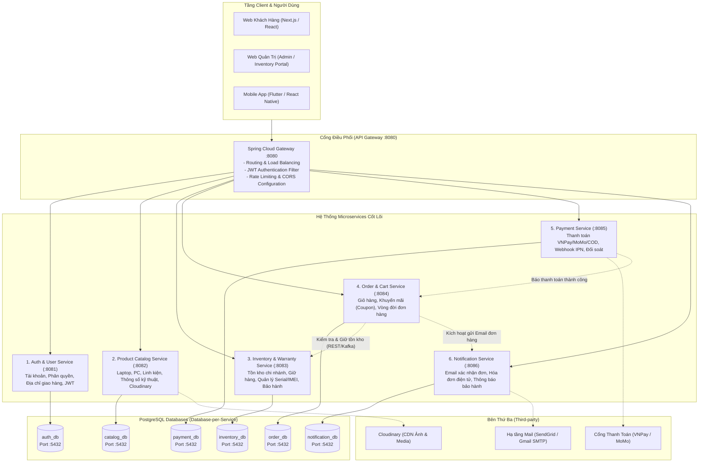
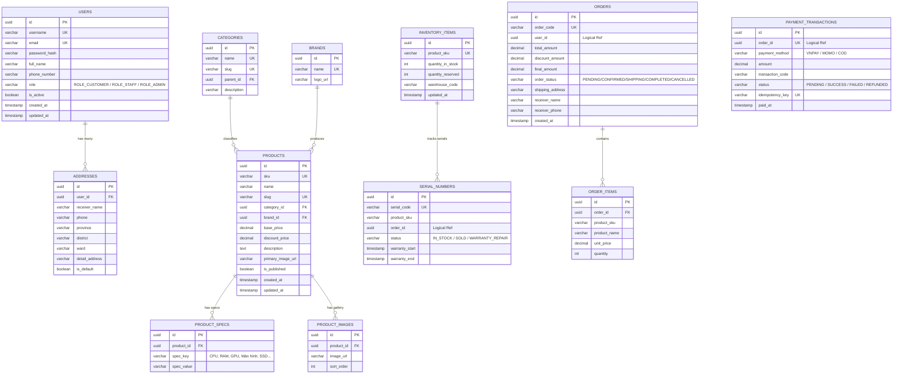
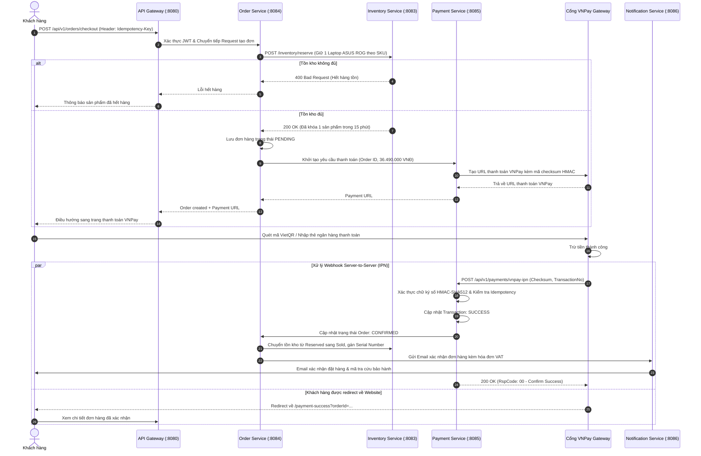

# KẾ HOẠCH & TÀI LIỆU THIẾT KẾ KIẾN TRÚC HỆ THỐNG E-COMMERCE MÁY TÍNH & LAPTOP (MICROSERVICES)

> **Dự án:** TechStore E-Commerce Microservices System  
> **Ngành hàng:** Máy tính để bàn (PC), Laptop, Linh kiện (CPU, GPU, RAM, Mainboard...), Màn hình & Phụ kiện Gaming  
> **Nền tảng công nghệ:** Java 17 LTS, Spring Boot 4.x / 3.x, Gradle Wrapper, PostgreSQL 15+, Spring Cloud Gateway  
> **Tiêu chuẩn thiết kế:** Chuẩn kiến trúc Microservices phân tầng (Layered Architecture: Controller - Config - Service - Repository - DTO - Entity - Exception), Database-per-Service.

---

## MỤC LỤC
1. [Tổng Quan Các Dịch Vụ Cốt Lõi](#1-tổng-quan-các-dịch-vụ-cốt-lõi)
2. [Tiêu Chuẩn Công Nghệ & Hạ Tầng](#2-tiêu-chuẩn-công-nghệ--hạ-tầng)
3. [Cấu Trúc Thư Mục & Phân Tầng Package Chuẩn](#3-cấu-trúc-thư-mục--phân-tầng-package-chuẩn)
4. [Mẫu Cấu Hình Build Gradle & Application Properties](#4-mẫu-cấu-hình-build-gradle--application-properties)
5. [Đặc Tả Các API Chính Của Các Dịch Vụ](#5-đặc-tả-các-api-chính-của-các-dịch-vụ)
6. [Thiết Kế Cơ Sở Dữ Liệu PostgreSQL (Database-per-Service)](#6-thiết-kế-cơ-sở-dữ-liệu-postgresql-database-per-service)
7. [Luồng Nghiệp Vụ Cốt Lõi (Sequence Diagram)](#7-luồng-nghiệp-vụ-cốt-lõi-sequence-diagram)
8. [Kế Hoạch & Lộ Trình Triển Khai Chi Tiết](#8-kế-hoạch--lộ-trình-triển-khai-chi-tiết)

---

## 1. TỔNG QUAN CÁC DỊCH VỤ CỐT LÕI

Hệ thống được thiết kế theo nguyên lý **Domain-Driven Design (DDD)** với các **Bounded Context** độc lập. Mỗi dịch vụ quản lý cơ sở dữ liệu riêng biệt (Database-per-Service), đảm bảo tính sẵn sàng, khả năng mở rộng (scalability) và độc lập trong triển khai (independent deployability).



### Bảng Phân Công & Trách Nhiệm Dịch Vụ
| STT | Tên Service | Port | Database PostgreSQL | Trách nhiệm chính trong hệ sinh thái máy tính |
| :---: | :--- | :---: | :--- | :--- |
| **1** | **API Gateway** | `8080` | *(Không dùng)* | Điểm tiếp nhận request duy nhất, xác thực JWT tập trung, phân luồng reverse proxy, cấu hình CORS, chống DDoS. |
| **2** | **Auth & User Service** | `8081` | `auth_db` | Đăng ký, đăng nhập (Access/Refresh Token), phân quyền RBAC (`ROLE_CUSTOMER`, `ROLE_STAFF`, `ROLE_ADMIN`), quản lý thông tin khách hàng và sổ địa chỉ giao hàng. |
| **3** | **Product Catalog Service** | `8082` | `catalog_db` | Quản lý danh mục (Laptop Gaming, Laptop Văn phòng, PC, CPU, GPU, RAM...), Thương hiệu (Asus, Dell, MSI, Apple...), biến thể SKU, thông số kỹ thuật (Specs: CPU, GPU, Tần số quét, Dung lượng), upload ảnh Cloudinary. |
| **4** | **Inventory & Warranty Service** | `8083` | `inventory_db` | Quản lý tồn kho theo chi nhánh/kho hàng, kiểm tra & giữ hàng (Reserve stock), **quản lý mã Serial Number / IMEI cho từng linh kiện/máy** (nghiệp vụ đặc thù cửa hàng máy tính), tra cứu kích hoạt bảo hành. |
| **5** | **Order & Cart Service** | `8084` | `order_db` | Quản lý giỏ hàng trực tuyến (Cart/CartItem), tạo đơn hàng (Checkout), mã giảm giá/voucher, quản lý trạng thái (`PENDING`, `CONFIRMED`, `SHIPPING`, `DELIVERED`, `CANCELLED`). |
| **6** | **Payment Service** | `8085` | `payment_db` | Khởi tạo giao dịch thanh toán online (VNPay, MoMo, ZaloPay, Thẻ tín dụng, COD), bảo đảm tính Idempotency, lắng nghe và xác thực chữ ký số Webhook/IPN Callback từ cổng thanh toán. |
| **7** | **Notification Service** | `8086` | `notification_db` | Gửi email xác nhận đặt hàng thành công, đính kèm hóa đơn điện tử VAT, thông báo trạng thái đơn hàng và nhắc hạn bảo hành sản phẩm. |

---

## 2. TIÊU CHUẨN CÔNG NGHỆ & HẠ TẦNG

- **Java Development Kit (JDK):** **JDK 17 LTS** (Hỗ trợ Record, Sealed Classes, Pattern Matching, Text Blocks).
- **Framework Cốt Lõi:** **Spring Boot 4.x / 3.x** (Spring Framework 6.x / 7.x, Jakarta EE 10).
- **Công Cụ Build:** **Gradle Multi-Project** kèm Gradle Wrapper (`gradlew`, `gradlew.bat`).
- **File Cấu Hình:** **`application.properties`** (Không dùng YAML để đảm bảo tính tường minh, hỗ trợ nạp biến môi trường dễ dàng).
- **Hệ Quản Trị Cơ Sở Dữ Liệu:** **PostgreSQL 15+** (Mỗi dịch vụ sở hữu 1 database độc lập; giao tiếp xuyên dịch vụ qua API contract, không bao giờ JOIN xuyên database).
- **Data Access Layer:** Spring Data JPA, Hibernate ORM 6.x.
- **Xác Thực & Bảo Mật:** Spring Security 6.x, JJWT (Java JWT v0.12+) với cơ chế RSA hoặc HMAC-SHA256 (Access Token ngắn hạn 15m, Refresh Token 7 ngày).
- **Lưu Trữ Ảnh/Media:** Cloudinary Java SDK v1.39+.
- **Xử Lý Lỗi Tập Trung:** `@RestControllerAdvice`, `ApiResponse<T>`, RFC 7807 Problem Details.

---

## 3. CẤU TRÚC THƯ MỤC & PHÂN TẦNG PACKAGE CHUẨN

Dự án áp dụng cấu trúc **Gradle Multi-Module**. Mỗi Microservice là một submodule độc lập và tuân thủ tuyệt đối cấu trúc phân tầng:

```plaintext
techstore-microservices/
├── .git/
├── gradle/
│   └── wrapper/
│       ├── gradle-wrapper.jar
│       └── gradle-wrapper.properties
├── build.gradle                               # Root build script quản lý dependencies chung
├── settings.gradle                            # Khai báo các submodules
├── gradlew
├── gradlew.bat
├── api-gateway/                               # Port 8080
├── auth-service/                              # Port 8081
├── catalog-service/                           # Port 8082
├── inventory-service/                         # Port 8083
├── order-service/                             # Port 8084
├── payment-service/                           # Port 8085
└── notification-service/                      # Port 8086
```

### Cấu Trúc Chi Tiết Trong Từng Service (Ví dụ: `catalog-service`):

```plaintext
catalog-service/
├── src/
│   ├── main/
│   │   ├── java/
│   │   │   └── com/techstore/catalog/
│   │   │       ├── config/                    # Cấu hình Bean: Cloudinary, WebMvc, Auditing
│   │   │       ├── constant/                  # Enum: CategoryType, ProductStatus, ErrorCode
│   │   │       ├── controller/                # REST Controllers: ProductController, CategoryController
│   │   │       ├── dto/                       # Data Transfer Objects
│   │   │       │   ├── request/               # ProductCreateDTO, ProductUpdateDTO, SpecFilterDTO
│   │   │       │   └── response/              # ProductResponseDTO, CategoryResponseDTO, ApiResponse
│   │   │       ├── entity/                    # JPA Entities: Product, Category, Brand, ProductSpec
│   │   │       ├── exception/                 # Custom Exceptions & GlobalExceptionHandler
│   │   │       ├── repository/                # Spring Data JPA Interfaces
│   │   │       ├── service/                   # Service Interfaces (ProductService, CategoryService)
│   │   │       │   └── impl/                  # Service Implementations (@Transactional)
│   │   │       └── CatalogServiceApplication.java
│   │   └── resources/
│   │       └── application.properties         # Cấu hình cổng, DB, Cloudinary, JPA
│   └── test/
└── build.gradle
```

### Quy Định Về Trách Nhiệm Từng Tầng:
1. **`config/`**: Khai báo `@Configuration`, các Bean như Cloudinary client, PasswordEncoder, cấu hình CORS, JPA Auditing (`@EnableJpaAuditing`).
2. **`constant/`**: Chứa enum trạng thái, thông điệp lỗi, hằng số cấu hình.
3. **`controller/`**: Tiếp nhận HTTP Request, validate dữ liệu đầu vào bằng `@Valid`, bọc phản hồi trong `ApiResponse<T>`, tuyệt đối không chứa business logic.
4. **`dto/request/`**: Đối tượng nhận dữ liệu đầu vào từ client, gắn các annotation validation (`@NotBlank`, `@NotNull`, `@Min`, `@Pattern`).
5. **`dto/response/`**: Đối tượng dữ liệu gửi trả về cho client. Tuyệt đối không để lộ trực tiếp JPA Entity ra ngoài.
6. **`entity/`**: Ánh xạ quan hệ cơ sở dữ liệu PostgreSQL. Chứa các trường ID (UUID hoặc BigInt), timestamps (`createdAt`, `updatedAt`).
7. **`exception/`**: Các ngoại lệ nghiệp vụ tự định nghĩa (`ResourceNotFoundException`, `DuplicateResourceException`, `AppException`) kế thừa từ `RuntimeException`, kết hợp `@RestControllerAdvice` bắt lỗi tập trung.
8. **`repository/`**: Giao tiếp với PostgreSQL thông qua Spring Data JPA, khai báo các derived query methods hoặc `@Query` JPQL/Native.
9. **`service/` & `service/impl/`**: Nơi xử lý toàn bộ nghiệp vụ, tương tác với Repositories, mapper DTO, transaction management (`@Transactional`).

---

## 4. MẪU CẤU HÌNH BUILD GRADLE & APPLICATION PROPERTIES

### 4.1. File `settings.gradle` Tại Thư Mục Gốc
```groovy
rootProject.name = 'techstore-microservices'

include 'api-gateway'
include 'auth-service'
include 'catalog-service'
include 'inventory-service'
include 'order-service'
include 'payment-service'
include 'notification-service'
```

### 4.2. File `build.gradle` Cho `catalog-service`
```groovy
plugins {
    id 'java'
    id 'org.springframework.boot' version '3.3.4'
    id 'io.spring.dependency-management' version '1.1.6'
}

group = 'com.techstore'
version = '1.0.0-SNAPSHOT'

java {
    toolchain {
        languageVersion = JavaLanguageVersion.of(17)
    }
}

repositories {
    mavenCentral()
}

dependencies {
    // Spring Boot Starters
    implementation 'org.springframework.boot:spring-boot-starter-web'
    implementation 'org.springframework.boot:spring-boot-starter-data-jpa'
    implementation 'org.springframework.boot:spring-boot-starter-validation'

    // PostgreSQL Driver
    runtimeOnly 'org.postgresql:postgresql'

    // Cloudinary SDK (Upload hình ảnh sản phẩm)
    implementation 'com.cloudinary:cloudinary-http44:1.39.0'

    // Lombok
    compileOnly 'org.projectlombok:lombok'
    annotationProcessor 'org.projectlombok:lombok'
    testCompileOnly 'org.projectlombok:lombok'
    testAnnotationProcessor 'org.projectlombok:lombok'

    // DevTools & Testing
    developmentOnly 'org.springframework.boot:spring-boot-devtools'
    testImplementation 'org.springframework.boot:spring-boot-starter-test'
}

tasks.named('test') {
    useJUnitPlatform()
}
```

### 4.3. File `application.properties` Mẫu Cho `catalog-service`
```properties
# ----------------------------------------------------
# APPLICATION & SERVER CONFIGURATION
# ----------------------------------------------------
spring.application.name=catalog-service
server.port=8082
server.servlet.context-path=/api/v1/catalog

# ----------------------------------------------------
# POSTGRESQL DATABASE CONFIGURATION
# ----------------------------------------------------
spring.datasource.url=jdbc:postgresql://${DB_HOST:localhost}:${DB_PORT:5432}/catalog_db
spring.datasource.username=${DB_USERNAME:postgres}
spring.datasource.password=${DB_PASSWORD:postgres}
spring.datasource.driver-class-name=org.postgresql.Driver

# ----------------------------------------------------
# JPA / HIBERNATE CONFIGURATION
# ----------------------------------------------------
spring.jpa.hibernate.ddl-auto=update
spring.jpa.show-sql=true
spring.jpa.properties.hibernate.format_sql=true
spring.jpa.properties.hibernate.dialect=org.hibernate.dialect.PostgreSQLDialect

# ----------------------------------------------------
# MULTIPART FILE UPLOAD CONFIGURATION (CLOUDINARY)
# ----------------------------------------------------
spring.servlet.multipart.max-file-size=10MB
spring.servlet.multipart.max-request-size=20MB

cloudinary.cloud-name=${CLOUDINARY_CLOUD_NAME:techstore_cloud}
cloudinary.api-key=${CLOUDINARY_API_KEY:your_api_key}
cloudinary.api-secret=${CLOUDINARY_API_SECRET:your_api_secret}
```

---

## 5. ĐẶC TẢ CÁC API CHÍNH CỦA CÁC DỊCH VỤ

### 5.1. Chuẩn Hóa Response Dạng `ApiResponse<T>`

Mọi endpoint trong hệ thống bắt buộc trả về một khung JSON chuẩn duy nhất:

* **Khi thành công (HTTP 200/201):**
```json
{
  "code": 200,
  "message": "Thao tác thành công",
  "data": { ... }
}
```

* **Khi thất bại (HTTP 400/404/500):**
```json
{
  "code": 400,
  "message": "Dữ liệu không hợp lệ",
  "errors": {
    "sku": "Mã SKU đã tồn tại trên hệ thống",
    "price": "Giá bán phải lớn hơn 0"
  }
}
```

---

### 5.2. Danh Sách API Cốt Lõi

#### A. Auth & User Service (`:8081`)
| Phương Thức | Endpoint | Quyền Hạn | Mô Tả |
| :--- | :--- | :--- | :--- |
| `POST` | `/api/v1/auth/register` | Public | Đăng ký tài khoản khách hàng mới |
| `POST` | `/api/v1/auth/login` | Public | Đăng nhập, nhận Access Token & Refresh Token |
| `POST` | `/api/v1/auth/refresh-token` | Public | Đổi Refresh Token lấy Access Token mới |
| `GET` | `/api/v1/users/profile` | Bearer Token | Lấy thông tin tài khoản hiện tại |
| `POST` | `/api/v1/users/addresses` | Bearer Token | Thêm địa chỉ nhận hàng (Tỉnh/Thành, Quận/Huyện, SĐT) |

#### B. Product Catalog Service (`:8082`)
| Phương Thức | Endpoint | Quyền Hạn | Mô Tả |
| :--- | :--- | :--- | :--- |
| `GET` | `/api/v1/catalog/products` | Public | Lấy danh sách sản phẩm phân trang, lọc theo danh mục, thương hiệu, khoảng giá, CPU, RAM |
| `GET` | `/api/v1/catalog/products/{slug}` | Public | Lấy chi tiết sản phẩm (Laptop/PC/Linh kiện) kèm thông số kỹ thuật chi tiết |
| `POST` | `/api/v1/catalog/products` | `ROLE_ADMIN` | Thêm sản phẩm mới (kèm ảnh upload lên Cloudinary, specs kỹ thuật) |
| `PUT` | `/api/v1/catalog/products/{id}` | `ROLE_ADMIN` | Cập nhật thông tin cấu hình, giá bán |
| `DELETE` | `/api/v1/catalog/products/{id}` | `ROLE_ADMIN` | Xóa hoặc tắt trạng thái kinh doanh sản phẩm |
| `GET` | `/api/v1/catalog/categories` | Public | Lấy cây danh mục sản phẩm (Laptop, PC, Linh kiện máy tính, Màn hình, Bàn phím) |
| `POST` | `/api/v1/catalog/categories` | `ROLE_ADMIN` | Tạo danh mục mới |

*Ví dụ Body tạo sản phẩm Laptop (`POST /api/v1/catalog/products` - `multipart/form-data`):*
```json
{
  "name": "Laptop Gaming ASUS ROG Strix G16 G614JVR",
  "sku": "ROG-G16-4060",
  "brandId": "550e8400-e29b-41d4-a716-446655440000",
  "categoryId": "6ba7b810-9dad-11d1-80b4-00c04fd430c8",
  "basePrice": 38990000,
  "discountPrice": 36490000,
  "description": "Laptop Gaming mạnh mẽ với Intel Core i9-14900HX và RTX 4060 8GB",
  "specs": {
    "cpu": "Intel Core i9-14900HX (24 cores, 32 threads)",
    "ram": "16GB DDR5 5600MHz",
    "storage": "1TB PCIe 4.0 NVMe M.2 SSD",
    "gpu": "NVIDIA GeForce RTX 4060 8GB GDDR6",
    "display": "16.0 inch QHD+ 240Hz ROG Nebula HDR",
    "weightKg": 2.5
  }
}
```

#### C. Inventory & Warranty Service (`:8083`)
| Phương Thức | Endpoint | Quyền Hạn | Mô Tả |
| :--- | :--- | :--- | :--- |
| `GET` | `/api/v1/inventory/stock/{productSku}` | Public / Internal | Kiểm tra số lượng tồn kho khả dụng của sản phẩm |
| `POST` | `/api/v1/inventory/reserve` | Internal (`OrderSvc`) | Giữ tồn kho tạm thời (15 phút) khi khách bắt đầu thanh toán |
| `POST` | `/api/v1/inventory/release` | Internal (`OrderSvc`) | Trả lại số lượng tồn kho nếu khách hủy hoặc thanh toán thất bại |
| `POST` | `/api/v1/inventory/serials` | `ROLE_ADMIN` | Nhập danh sách mã Serial Number / IMEI cho lô hàng mới về kho |
| `GET` | `/api/v1/inventory/warranty/check` | Public | Khách hàng tra cứu bảo hành theo mã Serial Number / SĐT |

#### D. Order & Cart Service (`:8084`)
| Phương Thức | Endpoint | Quyền Hạn | Mô Tả |
| :--- | :--- | :--- | :--- |
| `GET` | `/api/v1/orders/cart` | Bearer Token | Lấy danh sách sản phẩm trong giỏ hàng hiện tại |
| `POST` | `/api/v1/orders/cart/items` | Bearer Token | Thêm sản phẩm vào giỏ hàng |
| `DELETE` | `/api/v1/orders/cart/items/{sku}` | Bearer Token | Xóa sản phẩm khỏi giỏ hàng |
| `POST` | `/api/v1/orders/checkout` | Bearer Token | Đặt hàng (`Idempotency-Key` bắt buộc ở Header) |
| `GET` | `/api/v1/orders/my-orders` | Bearer Token | Lịch sử mua hàng của khách |
| `PUT` | `/api/v1/orders/{orderId}/status`| `ROLE_ADMIN` | Cập nhật tiến độ đơn hàng (`SHIPPING`, `DELIVERED`...) |

#### E. Payment Service (`:8085`)
| Phương Thức | Endpoint | Quyền Hạn | Mô Tả |
| :--- | :--- | :--- | :--- |
| `POST` | `/api/v1/payments/create-url` | Bearer Token | Tạo link thanh toán VNPay / MoMo với mã đơn hàng |
| `GET` | `/api/v1/payments/vnpay-callback` | Public (VNPay redirect)| Khách hàng redirect về sau khi thanh toán trên VNPay |
| `POST` | `/api/v1/payments/vnpay-ipn` | Public (Webhook VNPay) | Server-to-Server Webhook xác nhận giao dịch & chữ ký số checksum |

---

## 6. THIẾT KẾ CƠ SỞ DỮ LIỆU POSTGRESQL (DATABASE-PER-SERVICE)

Mỗi dịch vụ sở hữu cơ sở dữ liệu riêng biệt. Khóa chính dùng `UUID` (hoặc UUIDv7) để tránh xung đột dữ liệu phân tán. Mối quan hệ giữa các dịch vụ là **Logical Reference** (lưu `user_id`, `product_sku` dưới dạng UUID/String mà không dùng Foreign Key vật lý xuyên DB).



---

## 7. LUỒNG NGHIỆP VỤ CỐT LÕI (SEQUENCE DIAGRAM)

Luồng nghiệp vụ hoàn chỉnh: Khách hàng tiến hành đặt mua máy tính Laptop Gaming $\rightarrow$ Giữ hàng tồn kho $\rightarrow$ Thanh toán qua cổng VNPay $\rightarrow$ Nhận Webhook xác nhận $\rightarrow$ Khởi tạo bảo hành theo số Serial $\rightarrow$ Gửi email xác nhận.



---

## 8. KẾ HOẠCH & LỘ TRÌNH TRIỂN KHAI CHI TIẾT

Lộ trình được chia làm **8 Giai đoạn (Phases)** chuẩn chỉ:

### Giai Đoạn 1: Khởi Tạo Hạ Tầng Dự Án (Infrastructure & Base Setup)
- [ ] Thiết lập Gradle Multi-Project (`settings.gradle`, `build.gradle` gốc).
- [ ] Khởi tạo 6 cơ sở dữ liệu PostgreSQL trên môi trường phát triển (`auth_db`, `catalog_db`, `inventory_db`, `order_db`, `payment_db`, `notification_db`).
- [ ] Tạo module dùng chung (`common-lib` hoặc khung package chuẩn cho từng service) chứa: `ApiResponse<T>`, `GlobalExceptionHandler`, Custom Exceptions.

### Giai Đoạn 2: Auth & User Service (:8081)
- [ ] Xây dựng Entity `User`, `Address`, Enum `Role`.
- [ ] Cấu hình Spring Security 6.x & Service sinh/xác thực JWT (Access Token & Refresh Token).
- [ ] Viết API Đăng ký (`/register`), Đăng nhập (`/login`), Profile (`/profile`), Quản lý địa chỉ giao hàng.
- [ ] Viết Unit Test & Test API bằng Postman/Curl.

### Giai Đoạn 3: Product Catalog Service (:8082)
- [ ] Xây dựng Entity: `Product`, `Category`, `Brand`, `ProductSpec`, `ProductImage`.
- [ ] Cấu hình Cloudinary SDK để upload ảnh sản phẩm.
- [ ] Viết DTO Request/Response: `ProductCreateDTO`, `ProductUpdateDTO`, `ProductResponseDTO`.
- [ ] Viết Service & Controller: Tìm kiếm phân trang, lọc theo CPU/RAM/VGA/Giá, xem chi tiết sản phẩm.
- [ ] Viết CRUD Quản trị danh mục và thương hiệu.

### Giai Đoạn 4: Inventory & Warranty Service (:8083)
- [ ] Xây dựng Entity: `InventoryItem`, `SerialNumber`.
- [ ] Triển khai cơ chế kiểm tra và khóa tồn kho tạm thời (`reserveStock` & `releaseStock`).
- [ ] Xây dựng module quản lý số Serial / IMEI theo từng máy tính bán ra.
- [ ] Viết API tra cứu bảo hành online cho khách hàng.

### Giai Đoạn 5: Order & Cart Service (:8084)
- [ ] Xây dựng Entity: `Order`, `OrderItem`.
- [ ] Triển khai Giỏ hàng trực tuyến (Shopping Cart) lưu Database hoặc Redis.
- [ ] Xây dựng quy trình Checkout đơn hàng, hỗ trợ Header `Idempotency-Key` chống spam đơn trùng.
- [ ] Tích hợp gọi nội bộ (FeignClient hoặc RestClient) sang `InventoryService` để khóa hàng.

### Giai Đoạn 6: Payment Service (:8085)
- [ ] Xây dựng Entity `PaymentTransaction`.
- [ ] Tích hợp API tạo link thanh toán VNPay Sandbox (tạo URL, mã hóa checksum SHA512).
- [ ] Xây dựng API tiếp nhận Webhook IPN từ VNPay, kiểm tra tính toàn vẹn chữ ký và chống dội lại (Idempotency).
- [ ] Đồng bộ trạng thái đơn hàng khi thanh toán hoàn tất.

### Giai Đoạn 7: API Gateway (:8080) & Bảo Mật Tập Trung
- [ ] Cấu hình Spring Cloud Gateway định tuyến (Route) đến các port :8081 - :8086.
- [ ] Viết `JwtAuthenticationFilter` tại Gateway để kiểm tra token trước khi chuyển vào các service bên trong.
- [ ] Cấu hình CORS toàn cục cho phép Frontend kết nối an toàn.
- [ ] Cấu hình Rate Limiting chống spam request.

### Giai Đoạn 8: Notification Service (:8086) & Kiểm Thử Toàn Diện
- [ ] Cấu hình Spring Mail Sender gửi email template HTML khi có sự kiện thanh toán thành công.
- [ ] Viết Integration Test kiểm tra toàn bộ luồng từ Đặt hàng $\rightarrow$ Thanh toán $\rightarrow$ Trừ kho.
- [ ] Hoàn thiện tài liệu API OpenAPI / Swagger cho toàn hệ thống.
