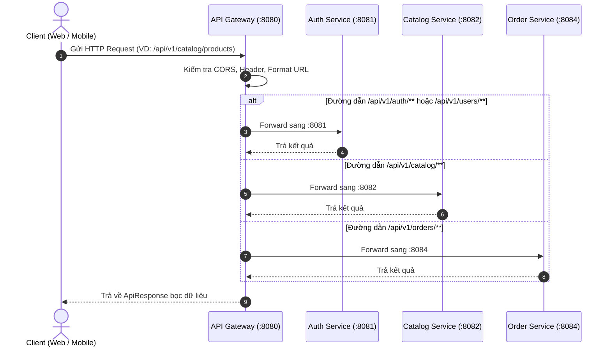
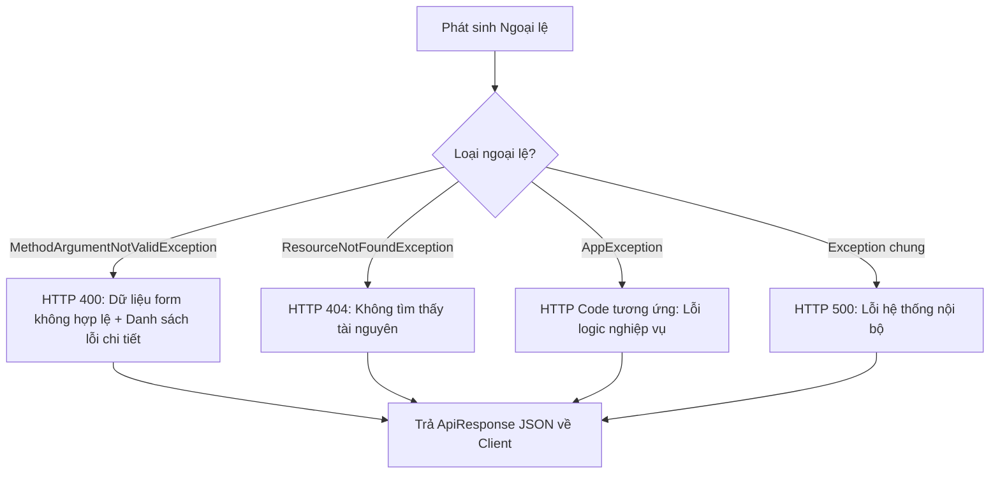

# 🌐 API GATEWAY SERVICE

> **Cổng giao tiếp duy nhất (Single Entry Point) cho toàn bộ hệ thống Microservices TechStore**

---

## 📌 1. TỔNG QUAN DỊCH VỤ

* **Vai trò:** Đóng vai trò là "cửa ngõ" đón nhận toàn bộ các HTTP Request từ phía Client (Web Frontend, Mobile App), thực hiện phân luồng (Routing), kiểm soát bảo mật (CORS, JWT Verification), chuẩn hóa phản hồi và xử lý lỗi tập trung trước khi chuyển tiếp vào các microservices nội bộ.
* **Cổng chạy mặc định (Port):** `8080`
* **Công nghệ sử dụng:**
  * Java 17, Spring Boot 4.x / Spring Cloud Gateway
  * Spring WebMvc
  * Lombok
  * Chuẩn hóa cấu trúc gói tin với `ApiResponse<T>`

---

## 📂 2. CẤU TRÚC THƯ MỤC MÃ NGUỒN

```text
api-gateway/
├── src/main/java/com/example/apigateway/
│   ├── ApiGatewayApplication.java         # Điểm khởi chạy chính của Gateway
│   ├── dto/
│   │   ├── request/                       # Các DTO nhận yêu cầu trung gian
│   │   └── response/
│   │       └── ApiResponse.java           # Lớp chuẩn hóa kết quả phản hồi chung (code, message, data, timestamp)
│   └── exception/
│       ├── AppException.java              # Ngoại lệ nghiệp vụ tùy biến
│       ├── ResourceNotFoundException.java # Ngoại lệ không tìm thấy tài nguyên (404)
│       └── GlobalExceptionHandler.java    # Bắt và đóng gói toàn bộ lỗi hệ thống bằng @RestControllerAdvice
└── src/main/resources/
    └── application.yaml                   # File cấu hình Routing và Gateway
```

---

## 🔄 3. TÓM TẮT CODE & GIẢI THÍCH CÁC LUỒNG HOẠT ĐỘNG (FLOWS)

### 3.1. Luồng định tuyến yêu cầu (Routing Flow)



* **Chi tiết luồng hoạt động:**
  1. Client chỉ cần biết duy nhất địa chỉ Gateway: `http://localhost:8080`. Không cần biết địa chỉ IP/Port của từng service phía sau.
  2. Gateway phân tích tiền tố của đường dẫn (`Path Prefix`):
     * `/api/v1/auth/**`, `/api/v1/users/**` $\rightarrow$ Điều hướng tới **Auth Service (:8081)**.
     * `/api/v1/catalog/**` $\rightarrow$ Điều hướng tới **Product Catalog Service (:8082)**.
     * `/api/v1/inventory/**` $\rightarrow$ Điều hướng tới **Inventory Service (:8083)**.
     * `/api/v1/orders/**` $\rightarrow$ Điều hướng tới **Order Service (:8084)**.
     * `/api/v1/payments/**` $\rightarrow$ Điều hướng tới **Payment Service (:8085)**.
     * `/api/v1/notifications/**` $\rightarrow$ Điều hướng tới **Notification Service (:8086)**.

---

### 3.2. Luồng chuẩn hóa phản hồi (`ApiResponse<T>`)

Tất cả các dịch vụ trong hệ thống đều tuân thủ cấu trúc phản hồi JSON đồng nhất:

```json
{
  "code": 200,
  "message": "Thao tác thành công",
  "data": { ... },
  "timestamp": "2026-10-21T20:15:00"
}
```

* `code`: Mã trạng thái nghiệp vụ (200, 400, 401, 403, 404, 500).
* `message`: Thông điệp phản hồi thân thiện với người dùng.
* `data`: Dữ liệu trả về (Object, List hoặc null).
* `timestamp`: Thời điểm phản hồi (tự động gán mặc định nhờ `@Builder.Default`).

---

### 3.3. Luồng xử lý lỗi tập trung (`GlobalExceptionHandler`)

Khi có ngoại lệ xảy ra trong quá trình xử lý, `GlobalExceptionHandler` với `@RestControllerAdvice` sẽ chặn lại và chuẩn hóa về dạng:



---

## 🚀 4. HƯỚNG DẪN KHỞI CHẠY

```bash
# Di chuyển vào thư mục api-gateway
cd api-gateway

# Biên dịch kiểm tra
./gradlew compileJava

# Chạy dịch vụ
./gradlew bootRun
```
Service sẽ lắng nghe tại: `http://localhost:8080`.
