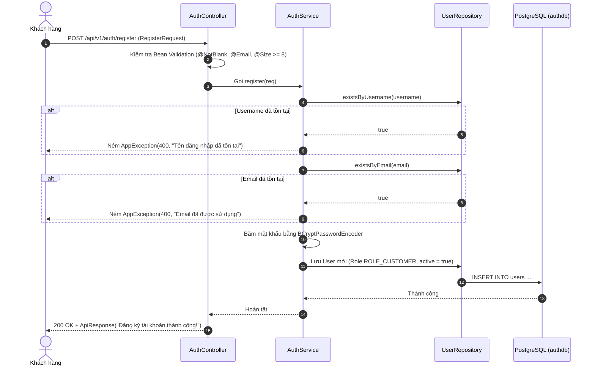
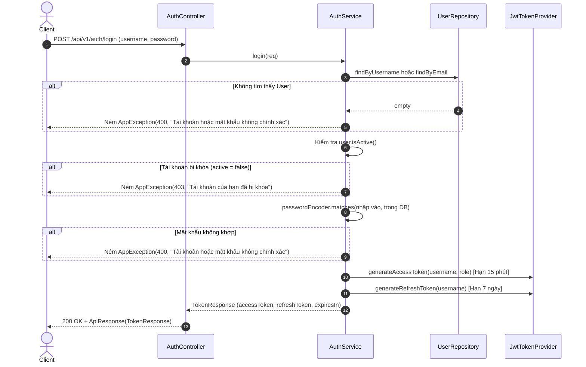
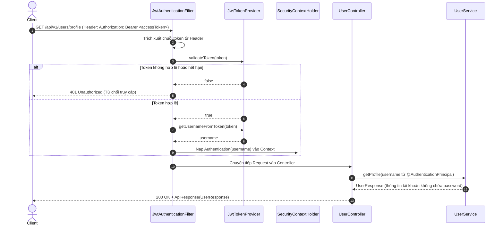

# 🔐 AUTH & USER SERVICE

> **Dịch vụ quản lý xác thực người dùng, bảo mật JWT và phân quyền hệ thống TechStore**

---

## 📌 1. TỔNG QUAN DỊCH VỤ

* **Vai trò:** Quản lý toàn bộ vòng đời tài khoản người dùng (Khách hàng, Nhân viên, Quản trị viên), thực hiện xác thực bảo mật qua JSON Web Token (JWT), phân quyền truy cập, băm mật khẩu một chiều BCrypt và quản lý địa chỉ nhận hàng của khách.
* **Cổng chạy (Port):** `8081`
* **Cơ sở dữ liệu:** PostgreSQL (`authdb`)
* **Công nghệ cốt lõi:**
  * Spring Boot 4.x, Spring Data JPA, Hibernate
  * Spring Security 6.x (Stateless Authentication)
  * Thư viện JJWT 0.12.6 (Java JWT)
  * Bean Validation (Jakarta Validation)
  * PostgreSQL Driver, Lombok

---

## 📂 2. CẤU TRÚC THƯ MỤC MÃ NGUỒN

```text
auth-service/
├── src/main/java/com/example/authservice/
│   ├── AuthServiceApplication.java         # Điểm khởi chạy Service
│   ├── config/
│   │   ├── JwtTokenProvider.java          # Sinh và kiểm tra Access Token (15p) & Refresh Token (7 ngày)
│   │   ├── JwtAuthenticationFilter.java   # Filter chặn Request, đọc Bearer Token và nạp SecurityContext
│   │   └── SecurityConfig.java            # Cấu hình Spring Security: CSRF off, Stateless, BCrypt Bean, phân quyền
│   ├── controller/
│   │   ├── AuthController.java            # API: /api/v1/auth/register, /login, /refresh-token
│   │   └── UserController.java            # API: /api/v1/users/profile
│   ├── dto/
│   │   ├── request/
│   │   │   ├── RegisterRequest.java       # Form đăng ký (@NotBlank, @Email, password >= 8 ký tự, SĐT)
│   │   │   ├── LoginRequest.java          # Form đăng nhập (username, password)
│   │   │   └── AddressRequest.java        # Form thêm/sửa địa chỉ nhận hàng
│   │   └── response/
│   │       ├── ApiResponse.java           # Chuẩn hóa Response JSON
│   │       ├── TokenResponse.java         # Cặp token JWT (accessToken, refreshToken, expiresIn)
│   │       ├── UserResponse.java          # Thông tin cá nhân an toàn (tuyệt đối không lộ password)
│   │       └── AddressResponse.java       # Thông tin địa chỉ nhận hàng
│   ├── entity/
│   │   ├── User.java                      # JPA Entity ánh xạ bảng 'users'
│   │   ├── Address.java                   # JPA Entity ánh xạ bảng 'addresses' (Many-to-One với User)
│   │   └── Role.java                      # Enum quyền hạn: ROLE_CUSTOMER, ROLE_STAFF, ROLE_ADMIN
│   ├── exception/
│   │   ├── AppException.java              # Ngoại lệ nghiệp vụ (trùng username/email, sai mật khẩu)
│   │   ├── ResourceNotFoundException.java # Ngoại lệ không tìm thấy tài khoản (404)
│   │   └── GlobalExceptionHandler.java    # Bắt lỗi toàn cục @RestControllerAdvice
│   ├── repository/
│   │   ├── UserRepository.java            # findByUsername, findByEmail, existsByUsername, existsByEmail
│   │   └── AddressRepository.java         # findByUser_Id, findByUser_IdAndIsDefaultTrue
│   └── service/
│       ├── AuthService.java               # Xử lý nghiệp vụ: Đăng ký, Đăng nhập, Làm mới Token
│       └── UserService.java               # Xử lý nghiệp vụ: Lấy thông tin cá nhân (Profile)
└── src/main/resources/
    └── application.yaml                   # Cấu hình Port 8081, PostgreSQL authdb, Secret Key JWT
```

---

## 🔄 3. TÓM TẮT CODE & GIẢI THÍCH CÁC LUỒNG HOẠT ĐỘNG (FLOWS)

### 3.1. Luồng Đăng ký tài khoản (`POST /api/v1/auth/register`)



---

### 3.2. Luồng Đăng nhập & Cấp phát JWT (`POST /api/v1/auth/login`)



---

### 3.3. Luồng Xác thực Token khi gọi API bảo mật (`GET /api/v1/users/profile`)



---

### 3.4. Luồng Làm mới Token (`POST /api/v1/auth/refresh-token`)

Khi `accessToken` hết hạn sau 15 phút:
1. Client gửi `refreshToken` (thời hạn 7 ngày) lên endpoint: `POST /api/v1/auth/refresh-token?refreshToken=...`.
2. `AuthService` kiểm tra tính hợp lệ và chữ ký số của Refresh Token.
3. Trích xuất username, kiểm tra tài khoản còn tồn tại trong hệ thống.
4. Cấp lại một `accessToken` mới thời hạn 15 phút mà không bắt người dùng phải đăng nhập lại mật khẩu.

---

## 📡 4. DANH SÁCH API ENDPOINTS

| Phương thức | Đường dẫn | Quyền truy cập | Mô tả |
| :--- | :--- | :--- | :--- |
| `POST` | `/api/v1/auth/register` | Public | Đăng ký tài khoản người dùng mới |
| `POST` | `/api/v1/auth/login` | Public | Đăng nhập nhận cặp Access Token & Refresh Token |
| `POST` | `/api/v1/auth/refresh-token` | Public | Dùng Refresh Token để xin cấp Access Token mới |
| `GET` | `/api/v1/users/profile` | Bearer Token | Lấy thông tin cá nhân tài khoản đang đăng nhập |

---

## 🚀 5. HƯỚNG DẪN KHỞI CHẠY

```bash
# 1. Đảm bảo PostgreSQL đang chạy và đã tạo cơ sở dữ liệu 'authdb'
# psql -U postgres -c "CREATE DATABASE authdb;"

# 2. Di chuyển vào thư mục auth-service
cd auth-service

# 3. Biên dịch dự án
./gradlew compileJava

# 4. Khởi chạy ứng dụng
./gradlew bootRun
```
Service sẽ lắng nghe tại: `http://localhost:8081`.
