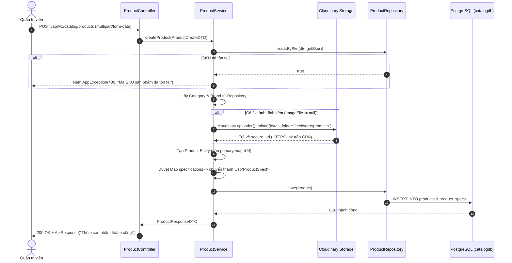

# 💻 PRODUCT CATALOG SERVICE

> **Dịch vụ quản lý toàn bộ Sản phẩm (Laptop, PC, Linh kiện), Danh mục đa cấp, Thương hiệu & Tải ảnh Cloudinary**

---

## 📌 1. TỔNG QUAN DỊCH VỤ

* **Vai trò:** Quản lý kho hàng sản phẩm công nghệ (Laptop Gaming, Máy trạm, Linh kiện PC), cấu hình thông số kỹ thuật chi tiết (CPU, RAM, GPU, Màn hình, SSD), xây dựng cây danh mục đa cấp (vd: Laptop $\rightarrow$ Laptop Gaming $\rightarrow$ ASUS ROG), quản lý thương hiệu và lưu trữ hình ảnh đa phương tiện trên nền tảng Cloudinary.
* **Cổng chạy (Port):** `8082`
* **Cơ sở dữ liệu:** PostgreSQL (`catalogdb`)
* **Công nghệ cốt lõi:**
  * Spring Boot 4.x, Spring Data JPA, Hibernate ORM
  * Cloudinary Java SDK (`cloudinary-http44:1.39.0`)
  * Bean Validation (Jakarta Validation)
  * Dynamic Query & Phân trang (`Pageable`, `@Query` JPQL)
  * Multipart Form Data (`@ModelAttribute` upload file đồng thời với form text)
  * PostgreSQL Driver, Lombok

---

## 📂 2. CẤU TRÚC THƯ MỤC MÃ NGUỒN

```text
catalog-service/
├── src/main/java/com/example/catalogservice/
│   ├── CatalogServiceApplication.java      # Điểm khởi chạy Service
│   ├── config/
│   │   └── CloudinaryConfig.java           # Khởi tạo Bean Cloudinary đọc từ application.yaml
│   ├── controller/
│   │   ├── ProductController.java          # API: Thêm, sửa, xóa, lấy chi tiết, lọc phân trang sản phẩm
│   │   ├── CategoryController.java         # API: CRUD danh mục + GET /tree (cây danh mục đa cấp)
│   │   └── BrandController.java            # API: CRUD thương hiệu (hỗ trợ upload logo qua form-data)
│   ├── dto/
│   │   ├── request/
│   │   │   ├── ProductCreateDTO.java       # Form thêm sản phẩm (MultipartFile, SKU, Giá, Specs Map)
│   │   │   ├── ProductUpdateDTO.java       # Form sửa sản phẩm (ảnh mới tùy chọn, cập nhật specs)
│   │   │   ├── CategoryRequestDTO.java     # Form thêm/sửa danh mục (tên, slug, parentId)
│   │   │   └── BrandRequestDTO.java        # Form thêm/sửa thương hiệu kèm file logo
│   │   └── response/
│   │       ├── ApiResponse.java            # Chuẩn hóa Response JSON
│   │       ├── ProductResponseDTO.java     # Chi tiết sản phẩm trả về cho Frontend
│   │       ├── CategoryResponseDTO.java    # Danh mục kèm danh sách con đệ quy (subCategories)
│   │       └── BrandResponseDTO.java       # Thông tin thương hiệu
│   ├── entity/
│   │   ├── Product.java                    # Bảng 'products' (SKU UK, giá, ảnh đại diện, published, timestamps)
│   │   ├── Category.java                   # Bảng 'categories' (cây cha-con đệ quy: parent_id)
│   │   ├── Brand.java                      # Bảng 'brands' (tên thương hiệu, logoUrl)
│   │   ├── ProductSpect.java               # Bảng 'product_specs' (specKey: CPU, RAM, GPU... / specValue)
│   │   └── ProductImage.java               # Bảng 'product_images' (album nhiều ảnh chi tiết)
│   ├── exception/
│   │   ├── AppException.java               # Ngoại lệ nghiệp vụ (trùng SKU, lỗi form)
│   │   ├── ResourceNotFoundException.java  # Ngoại lệ không tìm thấy sản phẩm/danh mục (404)
│   │   └── GlobalExceptionHandler.java     # Bắt lỗi toàn cục @RestControllerAdvice
│   ├── repository/
│   │   ├── ProductRepository.java          # Query lọc phân trang động (category, brand, giá, keyword)
│   │   ├── CategoryRepository.java         # findByParentIsNull (danh mục gốc), findBySlug
│   │   └── BrandRepository.java            # existsByName, findByName
│   └── service/
│       ├── ProductService.java             # Nghiệp vụ sản phẩm, upload/xóa ảnh Cloudinary, map DTO
│       ├── CategoryService.java            # Nghiệp vụ danh mục, tạo slug tự động, dựng cây đa cấp
│       └── BrandService.java               # Nghiệp vụ thương hiệu, upload logo lên Cloudinary
└── src/main/resources/
    └── application.yaml                    # Cấu hình Port 8082, catalogdb, Multipart 10MB, Cloudinary
```

---

## 🔄 3. TÓM TẮT CODE & GIẢI THÍCH CÁC LUỒNG HOẠT ĐỘNG (FLOWS)

### 3.1. Luồng Thêm mới sản phẩm có Upload ảnh (`POST /api/v1/catalog/products`)

> [!IMPORTANT]
> Vì người dùng gửi kèm cả **dữ liệu Text** (SKU, giá, mô tả, thông số kỹ thuật) và **file nhị phân** (`MultipartFile imageFile`), Controller bắt buộc phải sử dụng **`@ModelAttribute`** kết hợp `consumes = MediaType.MULTIPART_FORM_DATA_VALUE`.



---

### 3.2. Luồng Cập nhật sản phẩm & Thay thế ảnh Cloudinary (`PUT /api/v1/catalog/products/{id}`)

```mermaid
flowchart TD
    Start[PUT /api/v1/catalog/products/{id}] --> Find{Tìm Product theo ID}
    Find -->|Không thấy| Err404[Ném ResourceNotFoundException 404]
    Find -->|Tìm thấy| CheckImg{Có gửi kèm file ảnh mới không?}
    CheckImg -->|Có ảnh mới| DelOld[Trích xuất public_id ảnh cũ -> Gọi Cloudinary xoá ảnh cũ]
    DelOld --> UploadNew[Tải ảnh mới lên Cloudinary -> Nhận URL mới]
    UploadNew --> UpdateField[Cập nhật link ảnh mới vào Product]
    CheckImg -->|Không gửi ảnh mới| UpdateField
    UpdateField --> UpdateData[Cập nhật tên, giá, mô tả, category, brand, published]
    UpdateData --> UpdateSpecs[Xóa specs cũ -> Thêm danh sách specs mới]
    UpdateSpecs --> SaveDB[(Lưu vào PostgreSQL)]
    SaveDB --> Response[Trả về ProductResponseDTO cập nhật]
```

---

### 3.3. Luồng Tìm kiếm & Lọc phân trang động (`GET /api/v1/catalog/products`)

Tại [`ProductRepository.java`](file:///D:/KV/techstore/catalog-service/src/main/java/com/example/catalogservice/repository/ProductRepository.java), phương thức `filterProducts(...)` sử dụng JPQL thông minh:

```sql
SELECT p FROM Product p WHERE 
  (:categoryId IS NULL OR p.category.id = :categoryId) AND 
  (:brandId IS NULL OR p.brand.id = :brandId) AND 
  (:minPrice IS NULL OR p.basePrice >= :minPrice) AND 
  (:maxPrice IS NULL OR p.basePrice <= :maxPrice) AND 
  (:keyword IS NULL OR LOWER(p.name) LIKE LOWER(CONCAT('%', :keyword, '%')) OR LOWER(p.sku) LIKE LOWER(CONCAT('%', :keyword, '%'))) AND 
  (:published IS NULL OR p.published = :published)
```
* Client có thể truyền bất kỳ tham số nào (hoặc bỏ trống), câu lệnh sẽ tự động thích ứng mà không cần nối chuỗi SQL thủ công.
* Kết quả trả về tự động được chia trang (`Pageable`) kèm thông tin tổng số trang, tổng số bản ghi và thứ tự sắp xếp (`Sort`).

---

### 3.4. Luồng Cây danh mục đa cấp (`GET /api/v1/catalog/categories/tree`)

Hỗ trợ mô hình danh mục sâu không giới hạn cấp độ:
* **Cấp 1:** `Laptop` (parent_id = null)
  * **Cấp 2:** `Laptop Gaming` (parent_id = 1)
    * **Cấp 3:** `ASUS ROG` (parent_id = 2)

* **Cơ chế hoạt động:**
  1. `CategoryRepository.findByParentIsNull()` truy vấn tất cả các danh mục gốc cấp cao nhất.
  2. `CategoryService` sử dụng thuật toán **đệ quy (Recursion)** để duyệt từng node cha và gắn danh sách con `subCategories` vào `CategoryResponseDTO`.
  3. Frontend chỉ cần gọi 1 API duy nhất là có thể dựng hoàn chỉnh Menu đa cấp dạng Mega-menu.

---

## 📡 4. DANH SÁCH API ENDPOINTS

### 4.1. Sản phẩm (`/api/v1/catalog/products`)
| Method | Endpoint | Định dạng | Mô tả |
| :--- | :--- | :--- | :--- |
| `POST` | `/api/v1/catalog/products` | `multipart/form-data` | Thêm mới sản phẩm và upload ảnh đại diện |
| `PUT` | `/api/v1/catalog/products/{id}` | `multipart/form-data` | Cập nhật sản phẩm, thay ảnh mới và xóa ảnh cũ trên Cloud |
| `GET` | `/api/v1/catalog/products/{id}` | JSON | Lấy chi tiết thông tin sản phẩm theo ID |
| `GET` | `/api/v1/catalog/products/sku/{sku}` | JSON | Lấy chi tiết sản phẩm theo mã SKU |
| `GET` | `/api/v1/catalog/products` | JSON (Query Params) | Tìm kiếm & lọc phân trang (`categoryId`, `brandId`, `minPrice`, `maxPrice`, `keyword`, `page`, `size`, `sort`) |
| `DELETE` | `/api/v1/catalog/products/{id}` | JSON | Xóa sản phẩm và dọn dẹp ảnh trên Cloudinary |

### 4.2. Danh mục (`/api/v1/catalog/categories`)
| Method | Endpoint | Mô tả |
| :--- | :--- | :--- |
| `POST` | `/api/v1/catalog/categories` | Tạo danh mục mới (hỗ trợ `parentId` làm danh mục con) |
| `PUT` | `/api/v1/catalog/categories/{id}` | Cập nhật tên, slug, mô tả danh mục |
| `GET` | `/api/v1/catalog/categories/tree` | **Lấy toàn bộ cây danh mục đa cấp (Mega Menu)** |
| `GET` | `/api/v1/catalog/categories/{id}` | Lấy chi tiết danh mục theo ID |
| `GET` | `/api/v1/catalog/categories/slug/{slug}` | Lấy chi tiết danh mục theo URL slug chuẩn SEO |
| `GET` | `/api/v1/catalog/categories` | Lấy danh sách danh mục phẳng |
| `DELETE` | `/api/v1/catalog/categories/{id}` | Xóa danh mục |

### 4.3. Thương hiệu (`/api/v1/catalog/brands`)
| Method | Endpoint | Mô tả |
| :--- | :--- | :--- |
| `POST` | `/api/v1/catalog/brands` | Thêm thương hiệu mới (hỗ trợ upload file logo) |
| `PUT` | `/api/v1/catalog/brands/{id}` | Cập nhật tên và logo thương hiệu |
| `GET` | `/api/v1/catalog/brands/{id}` | Lấy chi tiết thương hiệu |
| `GET` | `/api/v1/catalog/brands` | Lấy danh sách toàn bộ thương hiệu |
| `DELETE` | `/api/v1/catalog/brands/{id}` | Xóa thương hiệu |

---

## 🚀 5. HƯỚNG DẪN KHỞI CHẠY

```bash
# 1. Đảm bảo PostgreSQL đang chạy và đã tạo cơ sở dữ liệu 'catalogdb'
# psql -U postgres -c "CREATE DATABASE catalogdb;"

# 2. Di chuyển vào thư mục catalog-service
cd catalog-service

# 3. Biên dịch dự án
./gradlew compileJava

# 4. Khởi chạy ứng dụng
./gradlew bootRun
```
Service sẽ lắng nghe tại: `http://localhost:8082`.
