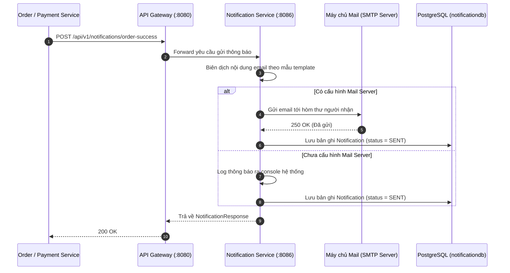

# Notification Service (:8086) - Dịch vụ Gửi Thông báo & Email

Notification Service phụ trách việc quản lý lịch sử thông báo, gửi email tự động xác nhận đơn hàng, cập nhật trạng thái thanh toán, và kích hoạt bảo hành cho khách hàng của TechStore.

---

## 1. Kiến trúc & Công nghệ
- **Framework:** Spring Boot 3.x / 4.x, Spring Data JPA, Hibernate.
- **Mail:** Spring Boot Starter Mail (`JavaMailSender`) hỗ trợ giao thức SMTP (Gmail, SendGrid, Amazon SES...).
- **Database:** PostgreSQL (`jdbc:postgresql://localhost:5432/notificationdb`).
- **Xử lý linh hoạt:** Tích hợp cơ chế fallback ghi nhận log trong môi trường development nếu chưa cấu hình thông tin SMTP thật.
- **Format chuẩn:** Dữ liệu phản hồi luôn được đóng gói trong `ApiResponse<T>`.

---

## 2. Luồng gửi thông báo đơn hàng (Notification Flow)



---

## 3. Danh sách RESTful APIs

| Method | Endpoint | Mô tả | Yêu cầu Body / Param |
| :--- | :--- | :--- | :--- |
| `POST` | `/api/v1/notifications/send-email` | Gửi email tùy biến chung | `recipient`, `subject`, `content`, `type`, `referenceId` |
| `POST` | `/api/v1/notifications/order-success` | Gửi email xác nhận đơn hàng thành công | `recipient`, `customerName`, `orderCode`, `totalAmount`, `paymentMethod` |
| `GET` | `/api/v1/notifications/recipient/{email}` | Lấy toàn bộ lịch sử thông báo gửi tới email | Path variable `recipient` |
| `GET` | `/api/v1/notifications/{id}` | Xem chi tiết 1 thông báo theo ID | Path variable `id` |

---

## 4. Cấu hình Mail SMTP (`application.yaml`)

```yaml
server:
  port: 8086

spring:
  mail:
    host: smtp.gmail.com
    port: 587
    username: your-email@gmail.com
    password: your-app-password
    properties:
      mail:
        smtp:
          auth: true
          starttls:
            enable: true
```
