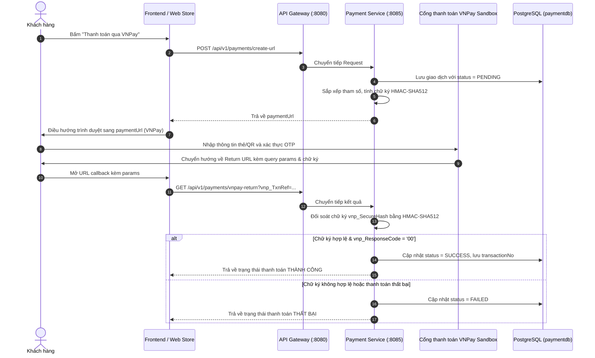

# Payment Service (:8085) - Dịch vụ Tích hợp Cổng thanh toán VNPay

Payment Service phụ trách xử lý giao dịch thanh toán cho hệ thống TechStore, tích hợp cổng thanh toán trực tuyến **VNPay Sandbox** theo chuẩn VNP 2.1.0 với cơ chế mã hóa bảo mật HMAC-SHA512.

---

## 1. Kiến trúc & Công nghệ
- **Framework:** Spring Boot 3.x / 4.x, Spring Data JPA, Hibernate.
- **Database:** PostgreSQL (`jdbc:postgresql://localhost:5432/paymentdb`).
- **Bảo mật:** Thuật toán mã hóa chữ ký số HMAC-SHA512 đối soát checksum 2 chiều (Request & Callback/IPN).
- **Format chuẩn:** Dữ liệu phản hồi luôn được bao bọc trong `ApiResponse<T>`.

---

## 2. Luồng tích hợp thanh toán VNPay (Payment Flow)



---

## 3. Danh sách RESTful APIs

| Method | Endpoint | Mô tả | Yêu cầu Body / Param |
| :--- | :--- | :--- | :--- |
| `POST` | `/api/v1/payments/create-url` | Tạo link redirect sang VNPay Sandbox | `orderCode`, `amount`, `orderInfo`, `ipAddress` |
| `GET` | `/api/v1/payments/vnpay-return` | Xử lý Callback/Return từ VNPay sau giao dịch | Các tham số query params của VNPay (`vnp_TxnRef`, `vnp_SecureHash`, ...) |
| `GET` | `/api/v1/payments/order/{orderCode}` | Tra cứu lịch sử & trạng thái giao dịch theo mã đơn hàng | Path variable `orderCode` |

---

## 4. Cấu hình VNPay Sandbox (`application.yaml`)

```yaml
vnpay:
  pay-url: "https://sandbox.vnpayment.vn/paymentv2/vpcpay.html"
  return-url: "http://localhost:8080/api/v1/payments/vnpay-return"
  tmn-code: "CGXZLS0Z"
  hash-secret: "XNBCJFAKAZQSGTARRLGCHVZWCIOIGSHN"
```
